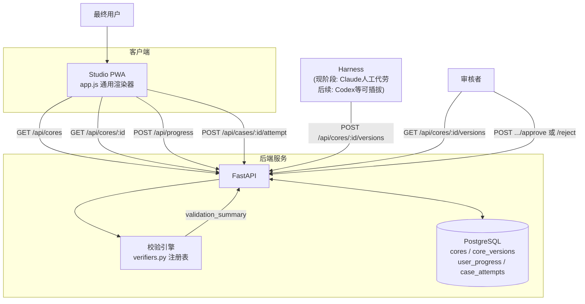
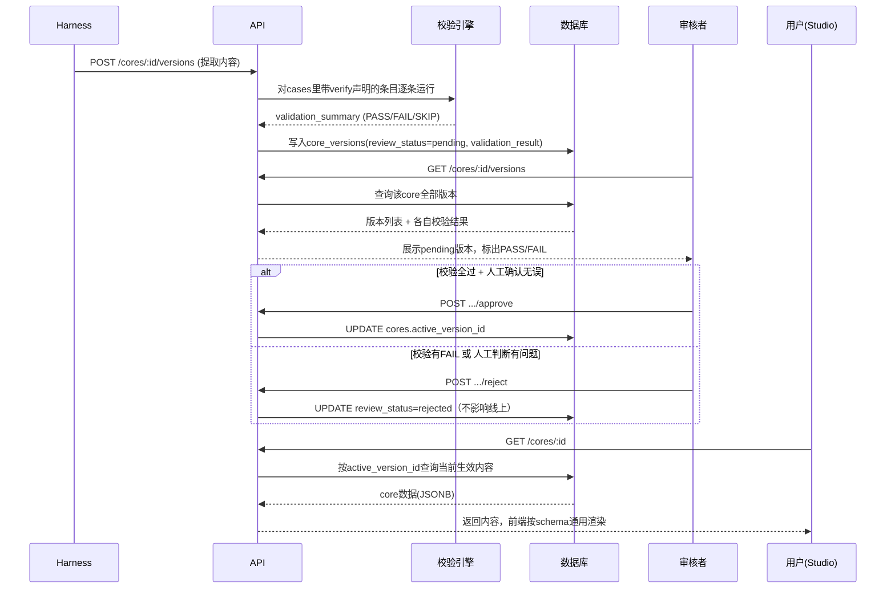

# Marrow 技术设计文档 v1.0

> 与《产品文档v0.2》的分工：产品文档回答"做什么、为什么、路线图怎么排"；这份文档回答"具体怎么搭"——面向要动手实现或接手代码的人。这里描述的每一项都对应已经写出并跑通测试的真实代码，不是设计意图。

> **2026-09 状态注记（先读这个）**：本文"系统架构/数据模型"两节描述的 PostgreSQL 审核流
> （`backend/main.py` + `schema.sql` + `seed.py`）是 **Phase-0 原型**，保留作设计参考，
> 与当前前端 PWA 的 API 契约不兼容。**当前产品后端是 `backend/platform.py`**——静态托管
> PWA、PDF 导入流水线、以 JSON 文件存储的学习数据（`data/progress.json` /
> `data/attempts.json`）。校验引擎（`validation/verifiers.py` + `run_validation.py`）与
> core schema 两套后端通用；单元测试见 `tests/`。
> 前端自 2026-10 起为 ES modules（`app/util.mjs` 转义、`app/expr_guard.mjs`
> 表达式守卫、`app/viz.mjs` 全部探索场景渲染器、`app/app.mjs` 应用壳/路由/页面），
> 交互走文档级事件委托（`data-nav` / `data-action`），零构建、零内联 onclick、零全局函数；
> `app/cores` 是 `cores/` 的符号链接，索引产物为 `app/cores-index.json`。
> 多用户学习数据（账号/会话/进度/作答/版本留痕）在 `backend/userstore.py`
> （SQLite 实现，表结构与本文第二节的 user_progress / case_attempts /
> core_versions 对齐，规模化时平移 PostgreSQL）。

## 一、系统架构总览



四个组件各自的职责边界：
- **Studio（前端）**：只读消费者，不做任何内容生产逻辑。通用渲染器读取core的`explorable`字段动态生成界面，parametric/definition_driven两种类型共用同一套`evalExpr`求值机制。
- **API（FastAPI）**：无状态，所有持久化都在数据库；不做业务规则判断，审核决定权在人（`reviewed_by`必填）。
- **校验引擎**：注册表模式，独立于API和数据库，可单独作为CLI工具运行（`run_validation.py`），也被API在提交时同步调用。
- **Harness**：当前是Claude在对话里手工完成提取，产出的JSON通过同一套`POST .../versions`接口提交——这个设计的意义是，换成Codex等真实harness时，接口不用改，只是调用方变了。

## 二、数据模型

完整DDL见`schema.sql`，核心关系：

```
cores (1) ──< core_versions (N)
  cores.active_version_id 指向当前生效的那一条 core_versions.id

users (1) ──< user_progress (N) >── cores
users (1) ──< case_attempts (N)
```

设计要点：
- `cores`表本身不存内容，只存指针（`active_version_id`）——所有实际内容在`core_versions.data`（JSONB），这样"发布新版本"变成一次UPDATE指针操作，旧版本天然保留、可追溯、可回滚。
- `core_versions.validation_result`（JSONB）存自动校验的结果快照，跟`data`绑定在同一条记录，审核时不需要重新计算就能看到当时的校验状态。
- `case_attempts`目前只记录单次尝试，没有做"多次尝试取最优"之类的统计——这类分析需求出现时再加，不提前设计。

Core内容本身的JSON结构见`marrow-core-schema-v1.json`（独立文件，是`core_versions.data`字段应该符合的schema）。

## 三、API契约

| 方法 | 路径 | 调用方 | 作用 |
|---|---|---|---|
| GET | /api/cores | Studio | 已发布core列表（摘要） |
| GET | /api/cores/:id | Studio | 单个core完整内容（当前生效版本） |
| POST | /api/progress | Studio | 更新用户学习进度 |
| GET | /api/progress/:user_id | Studio | 查询用户进度 |
| POST | /api/cases/:case_id/attempt | Studio | 记录用户对practice案例的作答 |
| POST | /api/cores | 管理端 | 注册新core（元数据，无内容） |
| POST | /api/cores/:id/versions | Harness | 提交新提取内容，自动触发校验，状态pending |
| GET | /api/cores/:id/versions | 审核者 | 查看某core全部版本+各自校验结果 |
| POST | /api/cores/:id/versions/:vid/approve | 审核者 | 批准，切换为线上生效版本 |
| POST | /api/cores/:id/versions/:vid/reject | 审核者 | 拒绝，不影响线上 |

## 四、核心流程：内容审核发布



## 五、前端渲染引擎设计

`app.js`的核心是两个函数：

- `evalExpr(expr, paramValues)`：用`new Function(...)`把schema里`outputs[].expr`这类字符串表达式，在给定参数值下求值。这是"studio通用、书可插拔"的关键——渲染逻辑只有一份，差异全部来自数据。
- `renderExplorable(exp)` / `updateExplorable()`：根据`explorable[].type`（parametric / definition_driven）生成滑杆和输出区，`type`只影响要不要显示`steps`文案，底层求值逻辑两者共用。

已知边界：目前只支持"数值/文本类输出"的通用渲染；自定义几何可视化（如最早那个矩阵-拉伸方格的SVG demo）不在这套通用机制覆盖范围内，仍需专属代码。

## 六、校验引擎设计

`validation/verifiers.py`是一个函数注册表（`REGISTRY`字典），每个函数对应一种"算法形状"：

- `matrix_of_linear_map`：欧式空间线性映射求矩阵
- `polynomial_derivative_matrix`：多项式求导映射求矩阵
- `eigenvector_check`：特征向量判定
- `minimal_poly_residual`：最小多项式系数验证

Core的`cases[].verify`声明用哪个函数、传什么参数、期望什么结果（`expected` / `expected_equal` / `expected_zero_vector`三种比较方式）。`run_validation.py`是通用runner，不关心具体是哪本书哪一节，只管读声明、调函数、报PASS/FAIL/SKIP。

**扩展方式**：遇到现有函数覆盖不了的算法形状（比如5A例5.9涉及的复数域运算），在`verifiers.py`里加一个新函数、注册进`REGISTRY`，旧case不用动。这是注册表模式的正常运作方式，不是要一次性穷尽所有数学结构。

## 七、已知技术债（诚实列出，原型阶段的合理简化，非生产就绪）

- **数据库连接未做连接池**：每个请求都新开一个`psycopg.connect()`，原型阶段够用，真实并发流量下需要换成连接池（如`psycopg_pool`）。
- **CORS完全开放**（`allow_origins=["*"]`）：原型阶段图方便，生产环境需要收紧到实际部署的前端域名。
- **管理端接口没有鉴权**：`POST /api/cores/:id/versions`、`approve`、`reject`目前任何人都能调，生产环境这些必须加权限校验，不能只靠"没人知道这个接口"。
- **无自动化测试套件**：目前的验证都是本次会话里手动跑的一次性脚本（虽然校验引擎本身是可复用的，但"API集成测试"没有沉淀成可重复运行的测试文件）。
- **`case_attempts`和`user_progress`还没有真正的用户认证体系**，`user_id`是裸整数，接入真实账号系统前不能上生产。

这些不是被忽略，是在"验证架构能不能走通"这个阶段被有意延后的——生产化清单，Phase 2后期需要按这张表逐项处理。
